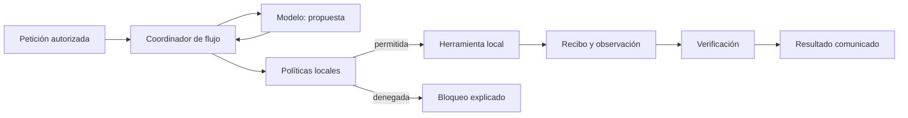

# Mizuki — vista técnica pública

Mizuki es un asistente de escritorio para Windows cuya arquitectura separa el razonamiento del modelo, la coordinación de tareas y la autoridad para ejecutar acciones. Este repositorio presenta una muestra pequeña del diseño para revisión por profesionales, colaboradores e investigadores.

> Este es un recorte de presentación, no la aplicación completa ni una distribución instalable. La publicación del repositorio no implica que todos los componentes descritos estén habilitados, disponibles o validados en todos los equipos.

## Qué contiene

- [`docs/ARQUITECTURA.md`](docs/ARQUITECTURA.md): recorrido de una petición y límites entre componentes.
- [`docs/SEGURIDAD.md`](docs/SEGURIDAD.md): principios de autoridad, ejecución y evidencia.
- [`docs/ESTADO_Y_ALCANCE.md`](docs/ESTADO_Y_ALCANCE.md): qué representa esta muestra y qué queda fuera.
- [`src/mizuki_public/workflow_contracts.py`](src/mizuki_public/workflow_contracts.py): extracto real y autocontenido del contrato de tareas del proyecto.

El módulo de contratos solo usa la biblioteca estándar de Python 3.10 o posterior. Define los orígenes reconocidos, los estados de resultado y los datos básicos de una tarea. No contiene un modelo de lenguaje, ejecutores, claves ni una aplicación de escritorio.

## Esquema

El diagrama es conceptual. Las fronteras descritas no sustituyen una auditoría del código completo ni constituyen una certificación de seguridad.

## Revisión profesional

Los comentarios técnicos pueden abrirse como *issues* en este repositorio. Para reportar una vulnerabilidad, evita incluir datos personales, credenciales, tokens o información de equipos. La muestra no habilita acceso a la instalación privada de Mizuki.

## Derechos de uso

Consulta [`NOTICE.md`](NOTICE.md). Este repositorio no incluye una licencia de software y no debe tratarse como una concesión de derechos de reutilización.
